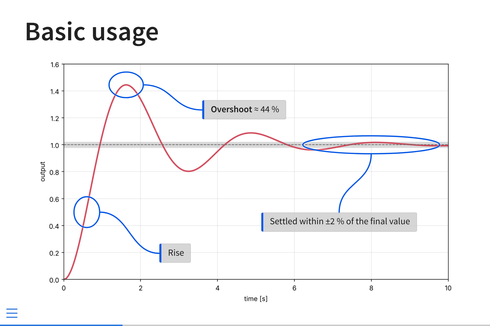

# Image Callout for Quarto RevealJS

Overlay one or more callouts on an image. Each callout is an **ellipse**
around a feature, a **text box**, and an **S-shaped leader** joining them.
Positions are fractions (0–1) of the image width and height, so they stay put
whatever size the image is rendered at. Styles come from CSS.



## Installation

```bash
quarto add pbosetti/revealjs-image-callout
```

This installs the extension under `_extensions/`. Check it into version
control if you use one.

## Usage

```yaml
---
format: revealjs
filters:
  - image-callout
---
```

```markdown
:::: image-callout


::: {.annotation x=0.5 y=0.2 tx=0.7 ty=0.3}
Callout text 1
:::

::: {.annotation x=0.7 y=0.3 tx=0.9 ty=0.8}
Callout text 2
:::
::::
```

* Leave a blank line after the image. Without it, Pandoc treats the following
  `:::` line as part of the image paragraph.
* The inner class is `.annotation`, not `.callout`. Quarto turns any
  `.callout` div into its own callout block before extension filters run.
* Using more colons on the outer fence (`::::`) is optional, but it makes the
  nesting easier to read.

See [`example.qmd`](example.qmd) for a complete deck.

## Attributes

On each `.annotation`:

| Attribute | Default | Meaning |
|-----------|---------|---------|
| `x`, `y`  | 0.5     | Centre of the ellipse |
| `w`, `h`  | 0.1     | Ellipse width and height |
| `tx`, `ty`| –       | Point where the leader meets the text box. Without them, only the ellipse is drawn. |
| `anchor`  | `auto`  | Side of the text box the leader enters: `left`, `right`, `top`, `bottom`, `center`. `auto` picks it from the relative position of ellipse and text. |
| `slack`   | 0.5     | How loose the S is: `0` is a straight line, `1` is a pronounced S. |
| `tw`      | –       | Fixed text box width (by default the box fits the text, up to `--ic-text-max-width`). |
| `color`   | –       | Accent colour for this callout (ellipse, leader, box edge). |
| `fragment-style` | – | Reveal fragment effect; see [Fragments](#fragments). |

Coordinates and sizes are fractions of the image width (`x`, `w`, `tx`, `tw`)
or height (`y`, `h`, `ty`). You can also write them as percentages: `x=50%`.

`w`, `h`, `anchor`, `slack`, `tw`, `color` and `fragment-style` can also be set on the
`.image-callout` container. They then act as defaults for all its annotations.

Any other class or attribute on an annotation stays on the callout's wrapper.
For example, `{.annotation .fragment fragment-index=2 ...}` makes the ellipse,
leader and text appear together as one fragment.

## Fragments

Make every callout of an image a fragment by adding `.incremental` to the
container:

```markdown
:::: {.image-callout .incremental}


::: {.annotation x=0.2 y=0.1 tx=0.4 ty=0.2}
Appears on the first click
:::

::: {.annotation x=0.8 y=0.4 tx=0.6 ty=0.7}
Appears on the second click; the first stays visible
:::
::::
```

To show **one callout at a time**, pick a reveal fragment effect with
`fragment-style`. Setting it already makes the container incremental:

```markdown
:::: {.image-callout fragment-style=fade-in-then-out}
```

| `fragment-style`        | Effect |
|-------------------------|--------|
| `fade-in` (default)     | callouts accumulate |
| `fade-in-then-out`      | one at a time: each callout disappears when the next one appears |
| `fade-in-then-semi-out` | the current callout is shown at full strength, earlier ones are dimmed |
| `fade-up`, `grow`, …    | any other [reveal fragment effect](https://revealjs.com/fragments/) |

* Callouts appear in document order. Use `fragment-index=n` on an annotation
  to change the order, or to show several callouts together.
* `.nonincremental` on an annotation keeps it always visible, for example a
  reference mark that stays while the others cycle.
* An annotation that already has `.fragment` keeps its own effect.
* `fragment-style` also works on a single annotation.
* Lists inside callout text are not made incremental.
* With `fade-in-then-out`, the last callout stays visible until you move to
  the next slide. This is how reveal's effect works.

### Geometry

* The leader leaves the ellipse at its left/right vertex, or at its top/bottom
  vertex for a vertical layout, perpendicular to the ellipse. It enters the text
  box perpendicular to the anchor side.
* With `anchor=left`, `(tx, ty)` is the middle of the box's left edge, so the
  box extends to the right. With `top`, it is the middle of the top edge and the
  box extends downwards, and so on.

## Image size

* **Top-level, no size given**: like Quarto's `auto-stretch`, the image
  fills the free height of the slide. Add `.nostretch` to the container to turn
  this off, or set `auto-stretch: false` in the YAML header.
* `{height=450px}`: fixed size. Callouts follow.
* `{width=60%}`: percentage of the slide width.
* Inside columns or other divs, the image keeps its natural size, capped at the
  column width.

A caption (``) is shown below the image, outside the
coordinate frame.

## Styling

The defaults look like a Quarto callout with a translucent grey body. Override
them with CSS custom properties, either on all callouts or on a class:

```css
.image-callout {
  --ic-accent: #0758e5;                 /* ellipse, leader, box edge */
  --ic-stroke: var(--ic-accent);        /* ellipse + leader only */
  --ic-stroke-width: 3px;
  --ic-halo: drop-shadow(0 0 1.5px rgba(255, 255, 255, .9));
  --ic-bg: rgba(200, 200, 200, .75);    /* text box background */
  --ic-color: #1a1a1a;                  /* text colour */
  --ic-border: rgba(0, 0, 0, .12);
  --ic-font-size: 0.55em;
  --ic-text-max-width: 40%;
  --ic-max-height: none;                /* cap for non-stretched images */
}

.image-callout.dark {                   /* ::: {.image-callout .dark} */
  --ic-bg: rgba(40, 40, 40, .7);
  --ic-color: #fff;
  --ic-accent: #ffb703;
}
```

These are the generated elements, in case you need more than the variables:
`.ic-stage` (image + overlays), `.ic-item` (one callout), `.ic-ellipse`,
`.ic-leader` (SVG), `.ic-text` (box, plus `.ic-anchor-<side>`), `.ic-caption`.

## Formats

The extension targets `revealjs`. It also works in `html`, but without
stretch. In other formats the markup is left as is.

## License

MIT
