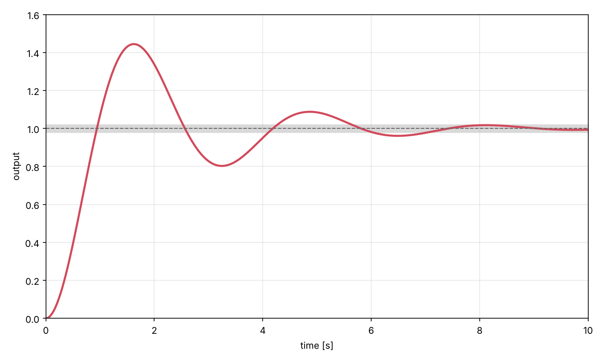

## Basic usage

:::: image-callout

::: {.annotation x=0.222 y=0.122 w=0.08 h=0.1 tx=0.4 ty=0.22}
**Overshoot** ≈ 44 %
:::

::: {.annotation x=0.13 y=0.619 w=0.06 h=0.12 tx=0.3 ty=0.78}
Rise
:::

::: {.annotation x=0.795 y=0.356 w=0.32 h=0.07 tx=0.72 ty=0.62}
Settled within ±2 % of the final value
:::
::::

## Incremental, coloured

:::: image-callout
{height=480px}

::: {.annotation .fragment x=0.222 y=0.122 w=0.08 h=0.1 tx=0.4 ty=0.22}
First the peak…
:::

::: {.annotation .fragment x=0.795 y=0.356 w=0.32 h=0.07 tx=0.55 ty=0.6 color="#d1495b"}
…then the steady state
:::

::: {.annotation .fragment .fade-up x=0.076 y=0.882 w=0.04 h=0.06 tx=0.2 ty=0.6 color="#2a9d8f" tw=0.25}
Starts from rest at $t=0$, with zero initial slope
:::
::::

## Options

:::: {.image-callout w=0.06 h=0.1 color="#6f42c1"}

::: {.annotation x=0.222 y=0.122}
:::

::: {.annotation x=0.4 y=0.48 tx=0.62 ty=0.7 anchor=top}
`anchor=top` (auto: `left`)
:::

::: {.annotation x=0.581 y=0.29 tx=0.82 ty=0.5 slack=1}
`slack=1`
:::

::: {.annotation x=0.581 y=0.29 tx=0.75 ty=0.16 slack=0}
`slack=0`
:::
::::

Container attributes set defaults; an annotation without `tx`/`ty` is just an ellipse.

## With a caption

:::: {.image-callout .dark}

::: {.annotation x=0.5 y=0.5 w=0.2 h=0.2 tx=0.8 ty=0.75 anchor=center}
`anchor=center`, dark style
:::
::::

